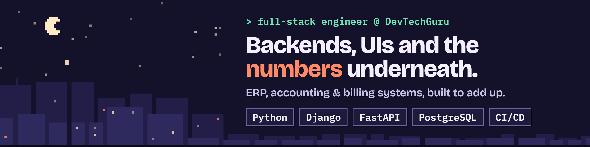

# Hi, I'm Ashiqur Rahman Shohan

<picture>
  <source media="(prefers-color-scheme: dark)" srcset="https://readme-typing-svg.demolab.com?font=IBM+Plex+Mono&weight=600&size=20&pause=1200&color=6FE3B5&vCenter=true&width=620&height=40&lines=Backend+APIs+in+Django%2C+FastAPI+and+Laravel;React+and+TypeScript+front+ends;PostgreSQL+and+MySQL+underneath;Ledgers+that+balance%2C+reports+that+add+up">
  
</picture>

Full-stack software engineer at DevTechGuru in Dhaka. I build backend services and REST APIs in Python (Django, FastAPI) and PHP (Laravel), React front ends, and the PostgreSQL and MySQL data models underneath. Most of my work is business software where the numbers have to add up: accounting, billing, ERP and reporting.

[Portfolio](https://shohan-portfolio.vercel.app) · [LinkedIn](https://www.linkedin.com/in/ashiqur-shohan) · [Résumé (PDF)](https://shohan-portfolio.vercel.app/resume.pdf) · [Email](mailto:ashiqur.shohan@gmail.com)

## What I work on

My DevTechGuru work lives in private repositories, so here's what it is:

- **EstateLink**, residential estate management, [live on the web](https://estatelinkconnect.com/), iOS and Android. One of a team of about 10. I built its shared server-side PDF, print and email pipeline (Django + Playwright), after which 16 PDF libraries were removed from the apps. I also rewrote the feed's visibility queries: mobile dashboard database time went from 1.1 s to 31 ms in a benchmark, with identical results.
- **Pascal**, an internal sprint and velocity platform the team uses every day. I designed and built it, then moved it from Supabase to a self-hosted FastAPI + PostgreSQL backend in phases, behind a feature flag. 303 unit tests were passing when Supabase was removed.
- **Guru ERP**, a retail ERP with touch point of sale, delivered to testing. I cut the backend test suite from 13m49s to 1m50s with 6 parallel workers, and worked on the touch checkout and the till hardware.
- **Accounting and reporting:** a double-entry loan module for a company's accounting ERP, and the daily cash report and Customer Retention Report for a salon ERP in production.

More detail, with diagrams, is in the [case studies on my portfolio](https://shohan-portfolio.vercel.app/projects).

## Stack

- **Backend:** Python, Django, Django REST Framework, FastAPI, PHP, Laravel, Node.js
- **Frontend and mobile:** React, TypeScript, Next.js, Redux Toolkit, TanStack Query, Zustand, Tailwind CSS, React Native (Expo)
- **Data:** PostgreSQL, MySQL, SQLAlchemy, Alembic
- **Testing:** pytest, Vitest, Jest, Playwright, Pest, PHPUnit
- **DevOps:** GitHub Actions, Nginx, Linux
- **Team workflow:** Scrum, Jira, Git, code review

## Writing

- [Review in any order, merge in order](https://shohan-portfolio.vercel.app/blog/review-in-any-order-merge-in-order): two stacked pull requests got merged out of order and broke our test server. How I fixed it, and the Git trap that comes after a revert.

## Contributions

<picture>
  <source media="(prefers-color-scheme: dark)" srcset="https://raw.githubusercontent.com/ashiqur-shohan/ashiqur-shohan/output/pacman-contribution-graph-dark.svg">
  
</picture>

## Background

I studied Statistics at the University of Chittagong. Next I'd like to grow toward data engineering, starting from the SQL-heavy side of my work: metrics computed by database triggers, query tuning and reporting.

The public repositories here are my own and course projects in Python (Django, DRF), React and Tailwind CSS.

Open to full-time roles and freelance work.
